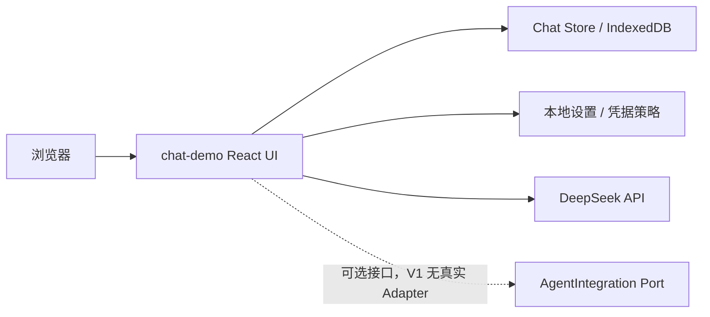
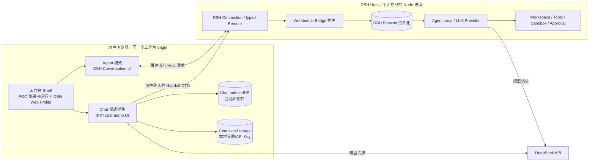

# DeepSeek Chat V1 与后续 DSH 集成架构方案

| 项目项 | 内容 |
|---|---|
| 文档状态 | Draft，按分阶段发布调整，待产品验收 |
| 版本 | 0.2 |
| 适用仓库 | `my-chat-demo` fork + 独立的 `my-deepseek-harness` fork |
| 目标 | 先独立发布完善后的 chat-demo；通过小型版本化适配接口为后续 DSH 集成留 seam |

## 1. 架构结论摘要

**V1 不接入 DSH，也不修改 DSH 源码。不要把整个 DSH 源码合并进 chat-demo，也不要在 chat-demo 里重写 DSH 的 Agent loop、Session、工具执行或权限系统。** V1 只完善 chat-demo，DSH 保持独立仓库与运行时。

分阶段路线：

1. **V1：Chat 独立产品。** 打磨 chat-demo 的对话、会话、设置、附件、错误恢复和发布体验；用户无需安装或运行 DSH。
2. **V1：只预留窄接口。** Chat 核心不依赖 DSH，定义版本化 Agent Adapter / Handoff DTO 类型；未配置真实 Adapter 时不显示可执行的 Agent 操作。
3. **V2：另行验证 DSH 接入。** V1 发布后，再做 DSH Web Profile 插件或独立 Workbench Shell 的 POC；以当时 DSH 的受支持 Host/Client 契约决定实现方式。
4. 未来产品可借鉴 ChatGPT/Codex 的工作区切换与会话边界，但不因导航统一而合并两边的会话格式或 Agent Runtime。

### 后续融合原则（不属于 V1 开发范围）

1. Chat 产品保留自己的 UI、存储、Provider 和用户体验。
2. 用户确认后由适配器通过 DSH 支持的认证接口创建新 Agent Session；DSH Host 继续持有工作区、工具、审批和执行策略。
3. 先做适配器/接口 POC，再决定使用 DSH Web 插件或独立 Shell；不要在 V1 同时研发两套产品界面。
4. 只有扩展点不足时才考虑对 DSH Web 增加通用 UI seam；不得为产品导航修改 DSH Agent 核心。

官方产品参考：[ChatGPT Work 与 Codex 的桌面产品结构](https://help.openai.com/en/articles/20001275-chatgpt-work-and-codex)；[基于开放 Agent Harness 构建产品](https://developers.openai.com/blog/codex-as-a-platform)。这些资料用于参考产品分层与集成原则，不表示 DSH 暴露了与 Codex app-server 相同的稳定协议。

### 是否要把 DSH 源码“合并进来”？

| 方案 | 结论 | 原因 |
|---|---|---|
| 将整个 `my-deepseek-harness` 复制/合并到 `my-chat-demo` | **不采用** | 形成重复的大型代码树，升级上游困难；混合静态 Chat 前端与 Node Host/原生运行时；放大依赖、发布、安全和测试负担。 |
| 在 chat-demo 中重写一个轻量 DSH | **不采用** | 重复实现 Agent loop、Session 日志、工具、沙箱、审批和模型提供方；久后会与 DSH 行为分叉。 |
| V1 先发布独立 chat-demo，定义 Adapter seam | **推荐首发方案** | 范围最小，不把 DSH 依赖引入首发；接口可以在没有 DSH 的情况下验证。 |
| V1 同时做 DSH Web 插件 | **暂不采用** | 会提前引入 DSH 版本、Client 打包、Host 连接和交接安全等工作，拖慢 Chat 独立发布。 |
| V2 在 DSH Web Profile 中加载 Workbench 插件 | **后续候选** | 利用 DSH Web 面板/插件 seam；需先验证耦合度和维护成本。 |
| V2 独立 Workbench Shell + DSH Host/Client 适配器 | **后续候选** | 产品控制力高；需验证 DSH 支持的协议、认证、生命周期和兼容承诺。 |
| 初期两个 Web 页面通过手动导出/导入 | **仅作临时可行性验证** | 能快速验证 Chat 到 Agent 的需求，但不达到单一工作台体验；不作为最终架构。 |

“对 DSH 源码做二次开发”不等于合并整个源码。优先用插件/Profile；插件边界确实不够时，只在自己的 DSH fork 增加**通用、窄范围的 Web UI 扩展点**，再决定是否向上游贡献。产品业务导航和 Chat 业务逻辑不要硬编码进 DSH 核心。DSH Agent Host 与 Session 能力仍作为独立运行时存在。

### 后续产品逻辑参考（不作为 V1 功能要求）

| ChatGPT 桌面产品 | 本产品建议 | 会话/运行时边界 |
|---|---|---|
| 全局 ChatGPT / Codex 切换器 | 全局 DeepSeek Chat / DSH Agent 切换器 | 切换能力工作区，不迁移当前会话 |
| Chat 与 Work 共享 Recents | Chat 与 Agent 聚合 Recent，并带类型、运行状态和来源 | 只聚合索引和入口，不统一存储格式 |
| Codex 保留独立历史和开发工作流 | DSH Agent 保留自己的 Session、工具事件与权限策略 | Handoff 创建新 Agent Session |
| 项目上下文可被相应体验显式选用 | 交接时由用户选择 DSH 工作区、目标和上下文 | 不自动把 Chat API 凭据/完整历史交给 DSH |
| 新应用可嵌入 Codex Harness，通过 app-server/SDK | DSH Workbench Bridge 作为适配层；接口能力需以当前 DSH 代码/文档 POC 验证 | 不假定 DSH 有 Codex app-server 的 API 稳定性 |

## 2. 现有仓库能力与集成 seam

### chat-demo

- React/TypeScript 静态 Web 客户端，直接连接 DeepSeek API。
- 聊天流程主要由 `src/services/chat/store.ts` 组织；API/SSE 在 `src/services/api/`；会话及附件在 IndexedDB；历史 ZIP 导入导出在 `src/services/chat/history/`。
- README 标明 API Key/settings 在浏览器 `localStorage`、聊天/附件在 `IndexedDB`，按 origin 隔离。
- 它没有能创建 DSH Agent Session 的后端桥接，也不能访问 DSH Host 本地工作区。

### DSH

- DSH 是 Cordis 插件组成的 Agent Harness；`web` Profile 组合客户端、Host、Agent、Session、模型、工具、工作区和权限插件。
- Web Client 已有模型与 Workspace UI 服务、Session/Workspace controller、类型化 Remote/Gateway、Conversation Chat target 和可扩展 Slots。
- Web UI 插件通过配置/profile patch 组装；本地开发可以用 `dsh web --patch <overlay>` 装载插件。
- DSH 会话是带工具/Agent 事件的持久日志；DeepSeek Chat 历史是另一种本地消息/ZIP 格式。二者不能直接互换。
- DSH 当前仍是开发者预览，插件/API 可能不兼容变化；产品需固定 DSH 版本并隔离适配器。

建议先阅读 DSH 仓库的 `docs/architecture.zh.md`、`docs/subsystems/web-client.zh.md`、`docs/user/develop/basic/index.zh.md`、`packages/client/ui-conversation/README.zh.md` 和 `packages/client/ui-workspace/README.zh.md`。当前 chat-demo 本地接口见 `src/services/chat/store.ts`、`src/services/chat/db.ts`、`src/services/chat/history/README.md`。

## 3. V1 拓扑与未来集成拓扑

### V1：独立 Chat 产品



V1 不启动 DSH Host，也不调用 DSH API。产品发布部署模式需另行确认：个人自托管 / 自备 Key 可继续浏览器直连；若面向公开用户且由产品代持密钥，则需另行设计服务端代理、用户认证、限流与密钥保护。

### 后续版本：DSH Adapter 拓扑



### 组件职责

| 组件 | 建议归属 | 职责 |
|---|---|---|
| V1 Chat UI / Store | chat-demo | 拥有普通聊天、历史和附件；无需 DSH 可完整运行。 |
| AgentIntegration Port | chat-demo 的小型集成边界 | 版本化能力发现、连接状态和交接请求/结果类型；V1 提供未连接状态，不含 DSH 实现。 |
| DSH Adapter（未来） | 独立模块/插件，归属待后续 POC 决定 | 适配 DSH 认证 Client/Host 契约，不让 Chat Store 直接依赖 DSH 类型。 |
| DSH Agent Runtime（未来） | 独立 DSH Host | 模型、Session 事件、工具调用、工作区访问、沙箱和审批。 |
| DeepSeek API | 外部提供方 | Chat 与 DSH 可分别调用；任何一边都不读取另一边的 API Key。 |

## 4. 集成策略与源码边界

### V1 阶段：接口预留，不做 DSH POC

V1 在 chat-demo 内定义并验证轻量集成 Port，不进入 DSH 仓库：

1. 在集成边界中定义 `AgentIntegration` 接口和 `HandoffRequest/Result` DTO。
2. DTO 带 schema version、来源 Chat ID、用户确认的任务、用户选定的上下文范围；禁止带 Provider Key、DSH 凭据或任意本机路径。
3. V1 使用 `NotConfigured` 实现或无 Adapter 状态；不显示可执行的 Agent 按钮，不发起 DSH 网络请求。
4. Chat 业务逻辑只依赖 Port，不直接 import DSH 包，也不改变 Chat 消息/历史 schema 来模拟 DSH Session。
5. 接口尽量少：先覆盖 capability/status、handoff/create、handoff/open 所需的抽象；未有真实使用者前不建通用 SDK、插件市场或事件总线。

接口形状可以先控制在类似下面的内部 TypeScript Port；它是工作台与未来适配器之间的边界，不等于现在就发布一个独立 SDK：

```ts
interface AgentIntegration {
  getStatus(): Promise<{ configured: boolean; adapterVersion?: string }>
  getCapabilities(): Promise<{ handoff: boolean; openSession: boolean }>
  createHandoff(request: HandoffRequest): Promise<HandoffResult>
  openSession(session: AgentSessionRef): Promise<void>
}
```

V1 的 `NotConfigured` 状态返回未连接能力；未来的 DSH Adapter 实现该接口并独立处理认证、Remote 调用、版本协商和错误映射。

V1 的接口验收条件：没有 DSH Adapter 时 Chat 功能完整可用；DTO 可序列化/版本校验且无秘密；替换为测试 Adapter 时能证明 Chat UI 与 DSH 细节隔离。真实 DSH Session 创建属于后续阶段。

### 后续阶段：DSH 集成 POC

V1 发布后，在固定 DSH 版本上验证真实 Client/Host 契约、`dsh web --patch` 插件组合、创建 Session、幂等与来源关联。根据验证结果选择 DSH Web 插件或独立 Workbench Shell；不默认要求修改 DSH 核心。

### 产品化阶段

- DSH 接入阶段再建立 DSH Adapter / Bridge；究竟放在 DSH fork、独立插件仓库还是工作区仓库，待后续 POC 和发布方式决定。
- 若 POC 通过，在 DSH Web Profile 中组合插件。开发阶段可用 patch overlay；发布阶段由固定版本的个人 Profile/安装包加载插件。若 POC 显示 Workbench 与 DSH UI 耦合过高，则 Workbench Shell 独立发布，通过经过认证的 DSH Client/Host 适配器连接。
- 只有选择 DSH Web 插件方案时，才将 chat-demo UI 拆成可装载模块；V1 不为尚未确认的 DSH 容器预先重构整个 UI。
- 若 UI 组合确实需要改 `ui-layout`/根导航，只新增通用 Slot/扩展点和本产品贡献者；避免在 DSH 核心内写死产品业务。
- DSH 的升级由 DSH fork 单独跟上游；Workbench 对 DSH 的依赖固定版本，由兼容适配器吸收 API 变化。

### 不能跨越的边界

- 不直接把 DeepSeek Chat assistant 的历史正文写成 DSH 的 assistant/tool/approval 事件。
- 不将 DSH Host 管理的 API 凭据下发给 Chat 浏览器，也不把 Chat `localStorage` API Key 交给 DSH。
- 不从 Chat 前端直接请求任意本机文件路径或自行执行命令；工具权限由 DSH Host 负责。
- 不将 DSH 的 Host 端口作为无认证的通用 REST 接口暴露到公网。

## 5. Handoff 数据契约

以下为后续集成的产品 DTO 草案，不是 DSH 内部 Session 格式。V1 可定义精简接口类型；工作区、附件上传与来源索引字段留待 DSH POC 确认，避免过早冻结完整交接协议。

```ts
type WorkbenchHandoffV1 = {
  version: 1
  handoffId: string             // 客户端生成的幂等 ID
  source: {
    app: 'chat-demo'
    chatSessionId: string
    title: string
    snapshotAt: number
  }
  task: {
    goal: string                // 用户明确可执行目标
    summary?: string            // 用户编辑或确认的摘要
    messages?: Array<{
      role: 'user' | 'assistant'
      text: string
      createdAt: number
    }>
    treatAsUntrustedContext: true
  }
  attachments: Array<{
    localId: string
    name: string
    mediaType: string
    size: number
    bytes?: Blob                // 仅在认证的上传流中发送，不序列化进 JSON
  }>
  target: {
    workspaceId: string
    agentPreset?: string
    permissionPreset?: string
  }
  consent: {
    userConfirmedAt: number
    includedTranscript: boolean
    includedAttachmentIds: string[]
  }
}
```

### 契约与处理规则

1. `handoffId` 在用户确认后生成/固定，Bridge 对同一 ID 的重试返回同一 DSH Session。
2. 服务端校验目标 Workspace 对当前用户/连接可见；不信任客户端传入的绝对路径。
3. `goal` 作为 Agent 的新人工任务；摘要和原聊天片段作为明确分隔的引用资料附带。导入文本是不可信输入，不能成为 system/developer 指令。
4. 创建 DSH Session 前校验附件大小、类型、数量和存储目标；文件原件缺失则要求用户移除或继续不带该附件。
5. Host 不接受客户端提供的 DeepSeek `file_id` 作为 DSH 本地文件访问凭据；附件字节需经 DSH 的认证上传接口写入 DSH 自己的附件存储。
6. 交接结果至少返回 `{handoffId, dshSessionId, status}`；Chat 本地记录二者关联。DSH 侧优先由 Bridge 持久化来源索引；如果 POC 发现这需要修改核心事件格式，则停下来重新评估，不直接扩展 Session 格式。
7. 未经用户选定，不传完整 transcript；不传 API Key、设置、隐藏思考块或未确认附件。

## 6. 数据与会话生命周期

| 数据 | 权威所有者 | v1 保存位置 | 备注 |
|---|---|---|---|
| Chat 消息/分支/标题 | chat-demo | 浏览器 IndexedDB | V1 保留并按 Chat 产品需求演进，不包含 DSH Session 字段。 |
| Chat API Key 和设置 | chat-demo | 浏览器 localStorage | 不进入 handoff DTO、不打日志。 |
| DSH Agent Session/工具/权限事件 | DSH | DSH Session 持久化 | 不尝试写成 DeepSeek Chat archive。 |
| DSH Agent 凭据和 Provider 配置 | DSH | DSH Profile/Credentials 服务 | 不与 Chat Key 合并。 |
| Agent Adapter 状态 | chat-demo Port | V1 无 Adapter；未来由适配器报告 | 不保存 DSH 凭据；未连接时隐藏 Agent 操作。 |
| Handoff 关联（未来） | Bridge + Chat | 后续阶段确定 | DSH Session ID 为目标引用；由后续契约决定持久化方式。 |
| Handoff 附件（未来） | DSH Attachment 服务 | DSH Host 管理 | 需在 DSH POC 验证；不属于 V1。 |

Chat 历史 ZIP 的导入/导出当前不会完整保留所有非图片附件原件。未来设计 Handoff 时必须以“用户此刻能从本地读取的原件”为准；历史归档里只有文件元数据、无字节时要明确显示无法转交。该规则不属于 V1 实现范围。

## 7. 关键决策记录（ADR 草案）

### ADR-01：DSH 保持独立运行时

- **状态：建议接受。**
- **决策：**V1 不接入或修改 DSH；后续不把 DSH 仓库作为子目录、submodule 或复制源码放入 chat-demo 产品树，通过独立 Adapter 对接其受支持 Host/Client 接口。
- **理由：**先发布 Chat，分离执行、安全和持久化所有权；保留两个仓库各自上游同步能力。
- **代价：**真正的一体化工作台需后续阶段建设和验证。

### ADR-02：Chat 转 Agent 创建新 Session

- **状态：后续阶段建议接受。**
- **决策：**未来 Handoff 创建新的 DSH Session；通过版本化 DTO 提供上下文和来源链接，不进行消息级双向同步。V1 只预留接口类型，不实现真实调用。
- **理由：**两种会话数据语义不同，DSH assistant 事件会代表工具调用、审批和可执行动作。
- **代价：**用户会看到两条相关记录；来源链接需要维护。

### ADR-03：先发布 Chat；DSH POC 放到后续阶段

- **状态：建议接受。**
- **决策：**V1 只交付独立 Chat 与轻量 Adapter seam，不做 DSH UI/Host 集成。V1 发布后再用 `dsh web --patch` 验证插件方式，并与独立 Shell 方案比较。
- **理由：**先验证 Chat 产品价值，降低首发范围和 DSH 预稳定接口带来的风险；集成边界仍保持可扩展。
- **代价：**V1 不具备 Chat/Codex 式双模式工作台或 Chat→Agent 真实执行能力。

### ADR-04：V1 部署和密钥模式需先确定

- **状态：待产品确认。**
- **决策：**若 V1 继续纯浏览器直连 DeepSeek，则定位为用户自备 API Key 的个人版；若要公开托管并代持 Key，应先设计后端代理、认证、限流和密钥保护。
- **理由：**产品发布方式决定 API Key 与用户数据边界，不能只按开发服务器的安全假设发布。
- **代价：**托管版需要额外服务端工作，不应假装只是静态前端发布。

## 8. 实施阶段与进入条件

| 阶段 | 范围 | 退出/验收条件 |
|---|---|---|
| 0. 产品验收 | 确认 V1 Chat 用户、功能、发布模式和 API Key 责任 | PRD 首发决策已确认；托管/自备 Key 边界明确。 |
| 1. Chat V1 开发与发布 | 在 `my-chat-demo` 完成已验收的 Chat 功能，完善存储、错误、响应式、设置和发行 | Chat 不依赖 DSH 可完整运行；按目标发布方式完成安全、构建和使用验收。 |
| 2. Adapter seam | 定义最小 `AgentIntegration` 接口和版本化 DTO；未配置实现不暴露 Agent 操作 | Chat 核心不依赖 DSH 包；接口契约可独立验证；没有真实 DSH 网络请求。 |
| 3. DSH 集成 POC | V1 发布后，用 DSH Profile/插件验证创建/打开 Agent Session、幂等和来源关联 | 根据结果选择插件壳、最小通用 Web 扩展或独立 Workbench Shell；确认 DSH 版本兼容策略。 |
| 4. 产品融合 | 实现用户确认的 Chat→Agent 交接、状态回链、必要附件流程和可选聚合 Recent | 两种会话仍独立；取消/失败/重试安全；DSH 权限策略完整保留。 |

V1 阶段不依赖 DSH POC 完成；只有进入阶段 3 后才需要动用 DSH Profile、插件或源码扩展。

## 9. 仓库、分支与发布策略

### `my-chat-demo`

- `main` 仅跟踪 DeepSeek 官方 `chat-demo` 上游。
- `dev` 承载 V1 Chat 二次开发和最小 Agent Adapter seam；不引入 DSH 依赖。
- DSH 的 Bridge/插件工作留到后续阶段；尽量把新增集成放入独立适配器，避免影响 Chat 核心和同步上游。

### `my-deepseek-harness`

- 独立维护 DeepSeek 官方 DSH 上游和自己的 fork。
- V1 不修改 DSH 仓库。后续集成 POC 先用本地插件和 Profile overlay，不直接修改核心包。
- 若必须改变 UI extension seam，建立窄范围 fork 提交/ADR，并将它作为可单独同步的上游贡献，而非拉入 chat-demo。
- Workbench 插件必须 pin DSH API 版本；每次升级 DSH 时运行插件契约和集成验证。

### 版本与兼容

- DSH 当前是开发者预览，不能假设插件接口向后兼容。将 DSH 版本号固定在工作台发布配置中。
- 每一版 Workbench 声明支持的 DSH 版本范围；启动时检测不兼容版本并给出明确错误，不静默退化到未经授权的执行路径。
- 复用两边 MIT 代码时保留各自 LICENSE 与第三方 notices。

## 10. 验证与测试计划（开发后执行）

本节是计划，不代表本轮已经运行测试。

### 单元/契约

- Handoff DTO schema/version 校验、摘要/消息裁剪、附件 manifest、幂等状态转换。
- API Key/secret 从 DTO、日志、URL 移除。
- 不能访问的 Workspace、无权限 Session、未知 preset、过大附件分别返回稳定可本地化错误。

### DSH 组合集成（后续阶段）

- 通过真实 `dsh web --patch` 加载 Workbench 插件；不只测试手工挂载的 mock。
- 在真实 DSH Profile 下创建、打开、取消、重复提交 Handoff；验证 Session 只创建一次且来源 ID 可读。
- 验证 DSH 写入审批/拒绝路径仍由原权限服务控制。

### 浏览器端 E2E

- Chat → 预览 → 编辑 → 取消：无 DSH Session。
- Chat → 预览 → 确认 → DSH Session → 返回 Chat：来源引用互相打开。
- 断网/DSH Host 停止/页面刷新/重复点击：无重复 Session，Chat 数据完整。
- 附件原件存在、缺失、超限和拒收路径。
- 键盘导航、窄视口回退、语言/主题。

### 部署验证

- Windows 本地 DSH Host 和浏览器。
- Rocky Linux/Fedora DSH Host，浏览器连接；需要远程访问时验证 TLS、可信域名和认证边界。
- 插件安装、升级、禁用、回滚、DSH 版本不匹配提示。

## 11. 风险与应对

| 风险 | 影响 | 应对 |
|---|---|---|
| DSH 插件/API 预稳定（后续） | 上游升级造成接口破坏 | 固定版本、独立适配器、升级契约测试；接入 POC 先确认可用 seam。 |
| Chat 与 DSH Session 语义不一致（后续） | 错误重建历史、误执行工具调用 | 新建 Session + 引用上下文，不合成历史 assistant/tool 事件。 |
| 导入对话中的 Prompt Injection（后续） | Agent 接受恶意引用文本 | 交接时标注 untrusted context；目标由用户另行确认；仍使用 DSH 安全策略。 |
| Chat 文件 ID 属于 DeepSeek 服务（后续） | DSH 无法读取源文件 | 用本地 Blob 经认证上传；没有 Blob 就不传并明确提示。 |
| Web Origin/CORS/Host 认证（后续） | 直接接 API 可能失败或削弱安全 | 优先受认证的 DSH Connection；不创建匿名 Host REST 入口。 |
| 用户将 DSH Host 公开到网络（后续） | 工作区和工具访问风险 | 远程访问需 TLS、认证、可信 Host 与最小权限部署。 |
| 直接改 DSH 上游核心导致难同步 | 升级成本高 | 插件优先；若需改，改通用扩展点并最小化/单独提交。 |
| DSH 与 chat-demo Node 版本不同 | 构建/运行兼容问题 | POC 固定 DSH 支持的 Node；Chat 静态 bundle 与 DSH Host 分开构建验证。 |

## 12. V1 产品验收与后续 POC 的输入

1. V1 Chat 的目标用户和首发必需功能清单。
2. V1 是个人自备 API Key，还是要提供托管 API 服务；后者需要哪些账号与后端能力。
3. 是否接受 V1 只定义 Adapter/DTO，不展示或执行 DSH 功能。
4. DSH 集成何时启动，以及是否需要 Rocky Linux/Fedora 的自托管 Host 支持。
5. 后续 Handoff 默认带可编辑摘要和手选消息，附件是否纳入首个 DSH 集成版本。

## 13. 参考资料

- chat-demo 仓库：`README.zh-CN.md`、`src/services/chat/store.ts`、`src/services/chat/db.ts`、`src/services/chat/history/README.md`。
- DSH 仓库：`README.zh.md`、`docs/architecture.zh.md`、`docs/subsystems/web-client.zh.md`、`docs/user/develop/basic/index.zh.md`、`packages/client/ui-conversation/README.zh.md`、`packages/client/ui-workspace/README.zh.md`、`packages/bundle/web-app/README.zh.md`。
- [DSH 官方架构文档](https://github.com/deepseek-ai/deepseek-harness/blob/master/docs/architecture.zh.md)
- [DSH Web UI 插件开发入门](https://github.com/deepseek-ai/deepseek-harness/blob/master/docs/user/develop/basic/index.zh.md)
- [OpenAI：ChatGPT Work 与 Codex 桌面产品结构](https://help.openai.com/en/articles/20001275-chatgpt-work-and-codex)
- [OpenAI：基于开放 Agent Harness 构建产品](https://developers.openai.com/blog/codex-as-a-platform)
