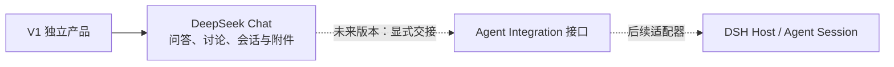

# DeepSeek Chat 产品 V1 需求方案（预留 DSH 集成）

| 项目项 | 内容 |
|---|---|
| 文档状态 | Draft，按分阶段发布调整，待产品验收 |
| 版本 | 0.2 |
| 日期 | 2026-11-18 |
| 产品代号 | DeepSeek Chat 工作台（名称待定） |
| 本轮范围 | V1 先完善并发布 chat-demo；定义后续 DSH 集成边界；本轮不实现功能 |

## 1. 产品概述

第一版先把 chat-demo 做成体验完整、可以独立使用和发布的 DeepSeek Chat 产品：

- **V1：DeepSeek Chat**：问答、讨论和澄清问题；沿用当前 React/TypeScript 前端、会话与附件存储，并围绕独立聊天产品完成体验打磨。
- **后续版本：DSH Agent 集成**：在需求和接口稳定后，用户可将 Chat 中确认的任务交给 DSH，在项目工作区继续处理。

V1 的核心价值是先交付好用、独立的 DeepSeek Chat。DSH 不属于首发功能；V1 只在架构上预留一个小而清晰的 Agent Integration 接口，暂不连接 DSH、创建 Agent Session 或展示虚假的 Agent 功能。

## 2. 现状与产品机会

当前 chat-demo 是无应用后端的浏览器客户端：模型请求直接发往 DeepSeek API，会话放在浏览器 IndexedDB，设置和 API Key 放在 `localStorage`。V1 优先在这个产品边界内完善 Chat 体验，不引入 DSH Host、远程执行或复杂账号服务。

DSH 是独立运行的 Agent Harness 和 Web 应用，已经提供模型路由、工作区、持久会话、工具、审批及插件组合。它不是另一个模型；DeepSeek 可以作为 DSH 的模型提供方。

后续组合的机会是连接“发现问题/形成方案”和“在真实项目中执行”。先把 Chat 独立产品做好，同时把未来交接收敛在适配器接口里，可以让 DSH 集成稍后加入，而不把 DSH 依赖渗透进聊天核心。

## 3. 目标用户与核心问题

### 目标用户

- V1 面向希望使用 DeepSeek 进行日常问答、讨论并管理聊天历史的个人用户。
- 后续目标用户包括希望把讨论结果带入本地代码/文档工作区继续执行的开发者和知识工作者。

### 需要解决的问题

1. 首发产品需要先把聊天、会话管理和本地数据体验打磨到可独立使用。
2. Chat 暂时不管理代码工作区或本机任务执行；这部分交给后续 DSH 集成。
3. 后续从 Chat 转向 Agent 时，应显式选择任务上下文并保留问题来源，不依赖粘贴全部历史。

## 4. 产品原则

1. **先做好 Chat。** V1 聚焦独立聊天产品，不让尚未实现的 DSH 流程拖慢首发。
2. **集成边界清晰。** 聊天核心不直接依赖 DSH 包、Host API 或 Session 格式；未来能力通过独立 Adapter 接入。
3. **交接显式。** 后续集成必须让用户确认任务目标、上下文和附件，再创建独立 DSH Session。
4. **凭据隔离。** Chat Provider 凭据不进入未来交接 DTO，也不暴露给 DSH Bridge。
5. **按发布模式确定安全边界。** V1 若保持浏览器直连 API，则明确采用用户自备 API Key；若产品代为托管密钥或请求，则发布前必须设计服务端代理、认证、限流和密钥保护。

## 5. 信息架构与交互

### 5.1 V1 信息架构

- V1 提供独立的 DeepSeek Chat 主界面，不展示无法使用的 DSH Agent 入口。
- 优先完成新建/切换/重命名/删除会话、历史浏览、输入与流式回复、设置和错误恢复等核心聊天路径。
- 现有 chat-demo 的导入导出与附件能力按产品验收确认后纳入首发范围。
- 代码结构预留 Agent Integration 适配器入口；没有适配器或能力未启用时，产品流程不依赖它。

### 5.2 后续版本：Chat → Agent

未来可在 Chat 会话上提供“交给 DSH Agent”操作。交接流程预期为：

1. 用户打开交接面板并选择本次要完成的任务目标。
2. 用户选择上下文范围：编辑摘要、选取关键消息，或附带完整文本记录。
3. 用户勾选要带入的本地附件；缺失原件或不支持传输的附件必须明确标出。
4. 用户选择 DSH 工作区、Agent preset 和访问/审批设置。
5. 显示最终交接预览和隐私提示；用户确认后才创建 DSH Session。
6. 成功后打开新 Session，并在原 Chat 与 DSH Session 中留下对方的可点击来源引用。

取消交接不创建 DSH Session。重复点击或网络重试不得创建重复任务。

### 5.3 后续版本：Agent 模式

- 复用 DSH 的会话、模型、工作区、工具、执行状态、审批与结果查看能力。
- 新任务必须有明确的 DSH 工作区；工作区选择、Agent preset 和当前访问级别在任务启动前可见。
- DSH Agent 的工具调用和有副作用操作继续由 DSH 权限策略负责，Chat 前端不自行执行项目命令。

## 6. 功能需求

优先级：P0 为独立 Chat 首发；P1 为 DSH 集成准备/后续集成；P2 暂缓。

| ID | 优先级 | 需求 |
|---|---:|---|
| FR-01 | P0 | Chat 会话可新建、切换、重命名、删除，并在刷新后按当前存储策略恢复。 |
| FR-02 | P0 | 核心对话支持输入、流式响应、停止生成、失败提示和可恢复重试。 |
| FR-03 | P0 | 用户能配置 DeepSeek API 连接和模型选项；密钥存储方式与首发部署模式一致，并明确告知用户。 |
| FR-04 | P0 | 用户可管理会话历史；纳入首发的导入/导出流程需保留其支持范围并明确附件限制。 |
| FR-05 | P0 | 附件上传、展示、删除和失败状态清楚；不会将附件 ID 误认为 DSH 可访问的本地文件。 |
| FR-06 | P0 | Chat 核心不因未来 DSH 不可用而受影响；V1 不要求部署或运行 DSH。 |
| FR-07 | P1 | 定义版本化 `AgentIntegration` 接口，覆盖能力发现、连接状态和提交/打开交接目标所需的最小操作。 |
| FR-08 | P1 | 定义不含凭据的版本化 `HandoffRequest` / `HandoffResult` DTO；未来 DSH Adapter 负责转换为 DSH 支持的 Host/Client 调用。 |
| FR-09 | P1 | V1 可以提供未配置 Adapter 的实现；未接入 DSH 时不展示可执行的 Agent 操作，也不发出网络请求。 |
| FR-10 | P2 | DSH 实际连接、工作区选择、附件传输、来源回链和聚合 Agent Recent。 |
| FR-11 | P2 | 多用户、云端会话同步、组织空间、托管执行和 SaaS 多租户。 |

## 7. 非功能要求

| 类别 | 要求 |
|---|---|
| 安全 | 不在 URL、日志或未来交接负载中携带 API Key；V1 按首发部署模式说明密钥存储和数据范围。 |
| 输入信任 | 导入的用户/助手聊天文本均作为不可信引用数据处理；其中的指令不得覆盖 DSH 系统/工具权限。 |
| 数据完整性 | V1 Chat 数据按现有产品存储策略保存；未来 DSH Session 由 DSH 持久化，交接失败不得损坏来源会话。 |
| 幂等性 | 未来用户确认的交接使用唯一 `handoffId`；Adapter 重试不得重复创建 Session。 |
| 可恢复性 | V1 Chat 不依赖 DSH 或集成 API；未来 DSH 不可用时 Chat 仍可独立使用。 |
| 可部署性 | V1 首发部署模式需在产品验收中确认；Rocky Linux/Fedora DSH 部署属于后续集成验证。 |
| 可维护性 | DSH 适配集中在独立 Adapter；Chat 核心不依赖 DSH 内部包或 Session 事件格式。 |
| 可访问性 | 模式、交接预览、错误与执行状态均有键盘焦点和屏幕阅读器可辨识的文本状态。 |

## 8. 验收标准

### AC-01：V1 独立 Chat

- Chat 主要使用路径不要求 DSH 已安装或正在运行。
- V1 不出现不可用的 Agent 模式或交接操作。
- Chat 会话按产品声明的存储策略创建、恢复、切换和删除。

### AC-02：集成接口隔离

- Chat store 和 UI 不直接导入 DSH 包或依赖 DSH Session 数据结构。
- Agent Adapter 通过独立接口注入；未配置时 Chat 能完整启动和使用。
- 接口与 DTO 带版本字段，且不包含 DeepSeek API Key 或 Host 凭据。

### AC-03：聊天主路径

- 流式响应、停止、错误和重试路径有清晰反馈。
- 会话切换、刷新和历史管理按产品声明的持久化行为工作。
- 附件状态和历史导入/导出限制明确可见。

### AC-04：未来交接契约

- V1 只需提供类型和接口边界，不要求已连接真实 DSH。
- 未来 Adapter 的契约测试覆盖确认/取消、幂等、失败状态和来源关联。

### AC-05：密钥与发布模式

- 用户能理解 V1 使用自己的 DeepSeek API Key，还是由服务端代为请求。
- 若浏览器持有用户 Key，界面和文档说明其本地保存位置与风险；日志、URL 和未来 DTO 不泄漏密钥。
- 若由产品服务端持有密钥，必须先补齐服务端认证、限流、滥用防护和密钥保护方案后才能发布该模式。

### AC-06：后续 Agent 安全边界

- 后续接入时，用户在任务开始前看到目标工作区、Agent preset 和访问/审批设置。
- Chat 内容作为引用/不可信上下文，写入、命令和其他副作用遵循 DSH 权限策略。

### AC-07：异常恢复

- V1 DeepSeek API 请求失败、停止和重试不损坏 Chat 历史。
- 后续 DSH Host 不可用、权限拒绝、文件传输失败有明确错误；重复交接不会重复创建成功的任务。

## 9. MVP 不做

- V1 不接入 DSH，不创建 DSH Session，不做 Chat/Agent 模式切换、跨产品 Recent 或交接 UI。
- 不在 Chat 模式执行本地 shell、写入项目或调用 DSH Agent 工具。
- 不把整个 DSH 仓库复制进 chat-demo，也不重写 Agent loop、安全沙箱或 Session 存储。
- 不在没有单独安全和运营方案的情况下托管用户密钥或提供多人 SaaS 服务。
- 不为了未来设想提前建设复杂插件市场、通用工作流引擎或多 Agent 编排。

## 10. 待产品验收的默认决策

| 决策 | 推荐默认值 | 验收时需确认 |
|---|---|---|
| 模式名称 | “DeepSeek Chat” / “DSH Agent” | 是否采用此命名及品牌呈现 |
| V1 发布方式 | 个人使用、用户自备 API Key（推荐暂定） | 是否要做公开托管服务；若是，需先确定后端和密钥方案 |
| V1 聊天能力 | 基于现有 chat-demo 打磨聊天主路径、历史、设置和附件 | 首发必须保留/新增的具体功能清单 |
| Adapter 预留 | V1 定义版本化接口和 DTO，不接真实 DSH | 是否同意 V1 仅预留接口、不显示 Agent 功能 |
| DSH 集成时间 | Chat 独立发布后另开阶段 | 后续是否采用 DSH Web 插件或独立 Workbench Shell |

## 11. 验收结论记录

- V1 产品定位和聊天能力清单：待验收。
- 首发部署方式与 API Key 责任边界：待验收。
- V1 是否只定义 Agent Adapter 接口而不连接 DSH：建议接受，待验收。
- DSH 集成：V1 发布后另行验收，不阻塞首发。
